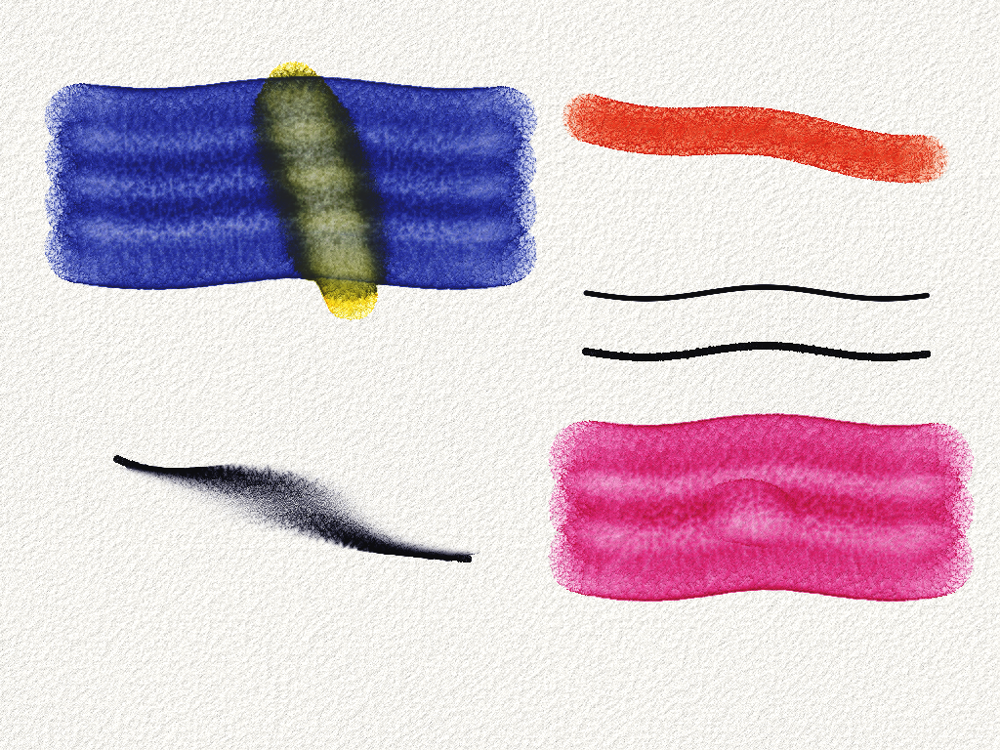

# Aqua

A minimal watercolour and ink painting app for Android. The paint is simulated
on the GPU: water flows across textured paper, pigment rides along and settles,
edges dry dark, and clear water dropped into damp paint blooms.

The UI is Kotlin and Jetpack Compose. The engine is Rust, using
[wgpu](https://wgpu.rs) (Vulkan, with a GLES 3.1 fallback) for the simulation
and rendering. Kotlin talks to it over JNI.



*A headless render from `engine/examples/paint_test.rs`: a wet-in-wet wash with
yellow dropped in, a dry red stroke, a technical-pen line, an India-ink line, India
ink feathering into a wet wash, and a bloom from clear water in a damp rose wash.*

## Features

- **Watercolour brush.** You set water and pigment load. The brush's reservoir
  runs out along a stroke, and a low-water brush turns into dry-brush texture
  that only catches the paper's peaks.
- **Clear water brush.** Wets paper, re-lifts unfixed pigment, and makes
  blooms (backruns) in damp washes.
- **Ink.** One slider goes from a technical pen to India ink. Pen ink is
  permanent as soon as it's laid down. India ink feathers along the paper
  fibres when the paper is wet, can be smeared by watercolour while it's still
  wet, and becomes permanent as it dries. Watercolour never moves dry or pen ink.
- **Eraser** and **eyedropper**.
- **Layers.** Each layer has opacity, visibility, reorder, clear, delete, its
  own drying speed, and a "dry now" button (also in the top bar while the active
  layer is wet). Layers stack with Kubelka-Munk optics, so glazes over a dry
  layer behave like real transparent paint.
- **Mixing palette**, in the style of FiftyThree's Paper. Dab pigments into a
  tray, swirl them together with your finger, and pick the result up as the
  brush colour. Mixing is done in K/S space, so blue and yellow make green, and
  what you mix in the tray is what the canvas paints. The tray and the colours
  you've mixed are kept between sessions.
- **Gallery** of saved paintings with thumbnails, duplicate, delete, and PNG
  export to `Pictures/Aqua`.
- **Undo/redo.** Tap two fingers to undo and three to redo, or use the
  buttons.
- **Navigation.** Pinch to zoom, pan and rotate. Once a stylus has been used,
  fingers only navigate (palm rejection).

## How the simulation works

Every layer keeps its pigment as Kubelka-Munk absorption `K` (rgb) and
scattering `S`, multiplied by the amount of pigment. Mixtures are just sums of
these, which is physically correct for paint. While a layer is wet it also has
surface water, paper saturation, pipe fluxes, suspended pigment, and wet ink.
Each simulation step runs four compute passes (`engine/src/shaders/`):

1. `flux.wgsl`: virtual-pipe shallow water. The paper's height pushes water
   into the valleys, and surface tension stops a thin film from creeping onto
   dry paper.
2. `transport.wgsl`: conservatively moves water, suspended pigment and wet ink
   along the fluxes.
3. `settle_water.wgsl`: the paper absorbs water, capillary action wicks it
   along the fibres, and water evaporates. The rim of a wet patch evaporates
   faster.
4. `settle_pigment.wgsl`: pigment diffuses in the water (wet-in-wet). A
   coffee-ring flow carries it towards the drying rim (dark edges). Capillary
   fronts push it (blooms). It settles faster in thin water and in paper
   valleys (granulation and flocculation), water can lift it again, and wet ink
   becomes permanent as the paper dries.

What keeps it fast:

- Only 32×32 tiles near wet paint are simulated, using a tile list for dispatch
  and a mask for neighbour lookups. Only the tiles that changed are
  recomposited.
- Layers below and above the active one are cached as one KM reflectance
  texture and one (reflectance, transmittance) pair. A frame only composites the
  active layer between them.
- All the dabs in a frame go out in one instanced draw with additive or
  multiplicative blending.
- Once a layer has dried (checked with an asynchronous GPU reduction), its wet
  state is released and the engine thread goes idle until the next touch.
- Undo stores 256×256 tiles copied on the GPU, captured lazily the first time
  each tile is written. This works because the simulation only touches active
  tiles.

## Building

Requirements: the Android SDK with NDK 27+, Rust with the
`aarch64-linux-android` and `x86_64-linux-android` targets, and
[`cargo-ndk`](https://github.com/bbqsrc/cargo-ndk).

```sh
rustup target add aarch64-linux-android x86_64-linux-android
cargo install cargo-ndk
./gradlew assembleDebug        # builds the Rust engine through cargo-ndk, then the app
adb install app/build/outputs/apk/debug/app-debug.apk
```

Gradle runs on JDK 21 (`gradle/gradle-daemon-jvm.properties`). It finds an
installed JDK 21 or downloads one.

### Engine without Android

The engine runs headless on any desktop GPU:

```sh
cd engine
cargo test --release --lib
cargo run --release --example paint_test -- /tmp/aqua_out   # writes PNGs of every brush and effect
cargo run --release --example bench                         # simulation timings at 2048×2048
```

Tuning constants for the physics are in `Tuning::default()` in
`engine/src/canvas.rs`.

## Layout

```
engine/            Rust engine (wgpu)
  src/canvas.rs    layers, simulation stepping, dabs, compositing, undo hooks
  src/brush.rs     stylus samples → spaced, smoothed dabs with a paint reservoir
  src/pigment.rs   Kubelka-Munk pigment model and presets
  src/palette.rs   CPU mixing tray
  src/storage.rs   save/load (lz4 f16 layers + meta.json + thumbnail)
  src/android.rs   JNI bridge and the engine thread
  src/shaders/     WGSL simulation, compositing, dabs, presentation
app/               Android app (Kotlin, Compose)
  ui/canvas/       canvas surface, gestures, tool dock, layers, palette, brush panels
  ui/gallery/      painting gallery and the new-canvas dialog
```
